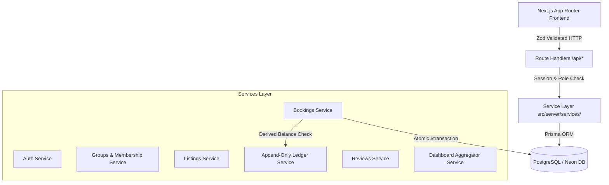
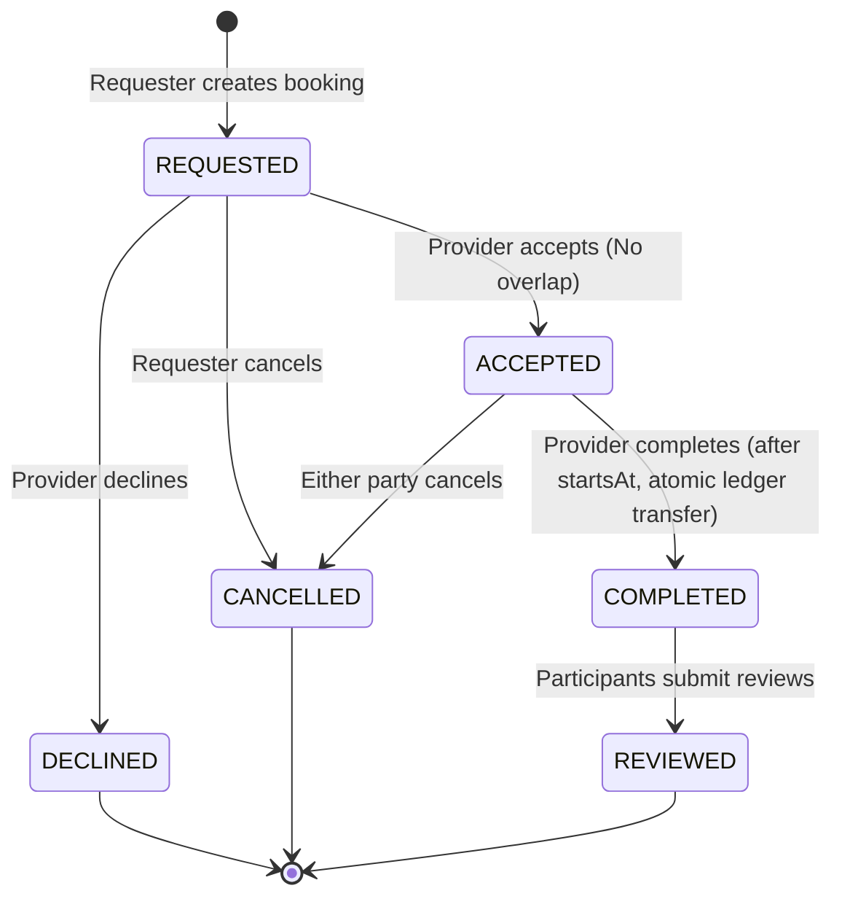
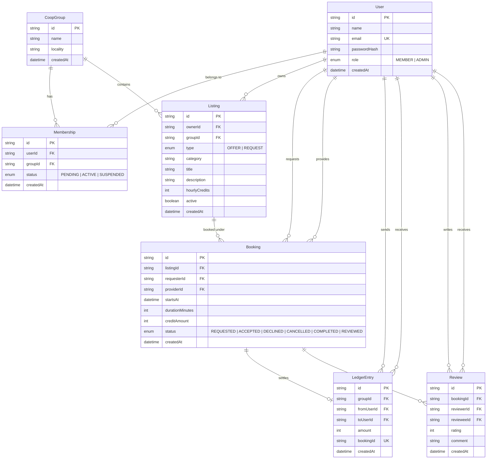

# System Architecture Document

## Cooperative Gig Services Platform for Household & Community Services

---

## 1. High-Level Module Architecture

The platform is designed around strict separation between HTTP route handlers and service business logic:

---

## 2. Booking State Machine

The platform strictly enforces the deterministic state machine in `BookingsService`:

### State Transition Validation Matrix:
| Initial State | Target State | Authorized Actor | Pre-Conditions | Side Effects |
| :--- | :--- | :--- | :--- | :--- |
| `[None]` | `REQUESTED` | Requester | Both parties ACTIVE members of group; requester $\neq$ provider | Creates booking in `REQUESTED` status |
| `REQUESTED` | `ACCEPTED` | Provider | No overlapping `ACCEPTED` booking for provider | Updates status to `ACCEPTED` |
| `REQUESTED` | `DECLINED` | Provider | None | Updates status to `DECLINED` |
| `REQUESTED` | `CANCELLED` | Requester | None | Updates status to `CANCELLED` |
| `ACCEPTED` | `CANCELLED` | Requester OR Provider | None | Updates status to `CANCELLED` |
| `ACCEPTED` | `COMPLETED` | Provider | Current time $\ge$ `startsAt`; Requester has balance $\ge$ creditAmount | Atomically writes `LedgerEntry` & updates status |
| `COMPLETED` | `REVIEWED` | Requester OR Provider | Booking in `COMPLETED` or `REVIEWED`; No prior review by caller | Writes `Review`, sets status to `REVIEWED` |

---

## 3. Data Model (Prisma Schema)

---

## 4. Append-Only Ledger Integrity

- **Derived Balance Formula**:
  $$\text{Balance}(\text{User}, \text{Group}) = \sum \text{LedgerEntry.amount}_{(\text{toUser}=\text{User})} - \sum \text{LedgerEntry.amount}_{(\text{fromUser}=\text{User})}$$
- **Non-Negativity Invariant**:
  $$\text{Balance}(\text{Requester}) - \text{creditAmount} \ge 0$$
- **Atomicity**: Executed inside Prisma's `$transaction(async (tx) => ...)`. If balance verification fails or ledger insertion collides, the entire status transition rolls back cleanly.
- **Idempotency**: `LedgerEntry.bookingId` has a `UNIQUE` constraint, guaranteeing that a booking can never be settled more than once.
